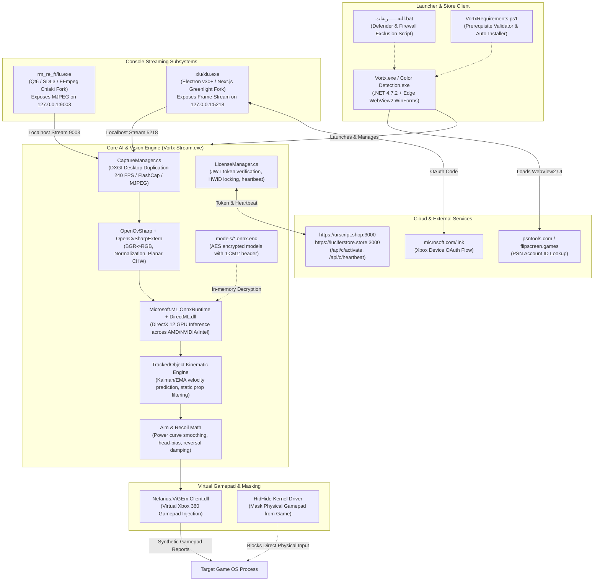

# Project: VORTX STORE Technical Inspection & Documentation

## Architecture
The inspected project `VORTX STORE` (internal code names: `Lucifer`, `Color Detection v2.5.0.0`, `lucifer_cv2`) is a specialized, distributed, hardware-accelerated computer vision and AI-powered gaming automation and streaming system targeting competitive first-person shooters (*Call of Duty: Black Ops 6/7*, *Modern Warfare*, *Warzone*).

---

## Feature Inventory
| # | Feature | Description | Milestone | Source |
|---|---------|-------------|-----------|--------|
| 1 | Directory & Path Encoding Resolution | Resolve Unicode RLM bytes (`\u200F\u200F`), map out directory tree and all 2,590 files (1.22 GB) | M1 | Survey (Explorer 1) |
| 2 | Binary & Architecture Inventory | Inventory 208 PE binaries, architectures (pure x64 AMD64), DLLs, and root cause analysis of quarantined `Vortx.exe` | M1 | Survey (Explorer 1) |
| 3 | Runtime & Prerequisite Specification | Document .NET 4.7.2/4.8, Edge WebView2, ViGEmBus, HidHide, and setup scripts (`VortxRequirements.ps1`, `التعــــــريفات.bat`) | M1 | Survey (Explorer 1, 2) |
| 4 | Application Entry Points & UI Architecture | Document `Vortx.exe`, `Vortx Stream.exe`, WinForms, WebView2, and embedded interfaces | M2 | Survey (Explorer 2) |
| 5 | Streaming Subsystems Integration | Document PS5 streaming (`lu.exe` / Chiaki fork on port 9003) and Xbox streaming (`xlu.exe` / Greenlight Electron fork on port 5218) | M2 | Survey (Explorer 1, 2) |
| 6 | Cloud APIs & Authentication | Document licensing endpoints (`urscript.shop:3000`, `luciferstore.store:3000`), JWT token format, PSN checker, and Microsoft link flow | M2 | Survey (Explorer 2) |
| 7 | Machine Learning Models Inventory | Document 4 encrypted ONNX models (`LCM1` header), YOLO11m / YOLOv8 architectures (320px, 640px, 1280px), target classes | M3 | Survey (Explorer 3) |
| 8 | Vision Capture & Inference Pipeline | Document DXGI Desktop Duplication (240 FPS), FlashCap, OpenCvSharp preprocessing, ONNX Runtime with DirectML GPU acceleration | M3 | Survey (Explorer 3) |
| 9 | Kinematic Tracking & Aim Assist Engine | Document `TrackedObject` velocity extrapolation, static prop rejection, power curves, head-bias offsets, anti-recoil | M3 | Survey (Explorer 3) |
| 10 | Gamepad Virtualization & Cloaking | Document ViGEmBus virtual Xbox 360 stick deflection injection and HidHide physical controller masking | M3 | Survey (Explorer 2, 3) |
| 11 | Comprehensive Technical Documentation Deliverable | Generate and deliver master technical report `TECHNICAL_ANALYSIS_REPORT.md` satisfying all requirements and acceptance criteria | M4 | ORIGINAL_REQUEST §R1-R3 |

---

## Milestones
| # | Name | Scope | Dependencies | Status |
|---|------|-------|-------------|--------|
| M1 | Directory & Architecture Inventory | Survey and map directory structure, PE binaries, runtime dependencies, quarantine analysis | none | DONE |
| M2 | Component & Technology Analysis | Survey application entry points, UI layers, streaming subsystems, cloud integrations | M1 | DONE |
| M3 | ML & Vision Pipeline Analysis | Survey models (`.onnx.enc`), DirectML inference, DXGI capture, kinematic tracking, input injection | M1 | DONE |
| M4 | Comprehensive Documentation Deliverable | Worker authors and outputs `TECHNICAL_ANALYSIS_REPORT.md` in target directory and project workspace | M1, M2, M3 | DONE |

---

## Interface Contracts
### Deliverable Contract ↔ Working Directory
- **Primary Deliverable Target Path**: `c:\Users\96655\Downloads\__VORTX STORE_ نسخة\VORTX STORE_ نسخة\TECHNICAL_ANALYSIS_REPORT.md`
- **Secondary Mirror Path**: `c:\Users\96655\Downloads\__VORTX STORE_ نسخة\‏‏VORTX STORE_ نسخة\Vortx (1)\Vortx\Vortx_buy\TECHNICAL_ANALYSIS_REPORT.md`
- **Workspace Reference Path**: `c:\Users\96655\ui\aim_trainer_project\.agents\teamwork\orchestrator\TECHNICAL_ANALYSIS_REPORT.md`
- **Report Status**: Successfully generated (51,508 bytes, 675 lines), audited CLEAN, and approved by 2 Reviewers and 2 Challengers.
