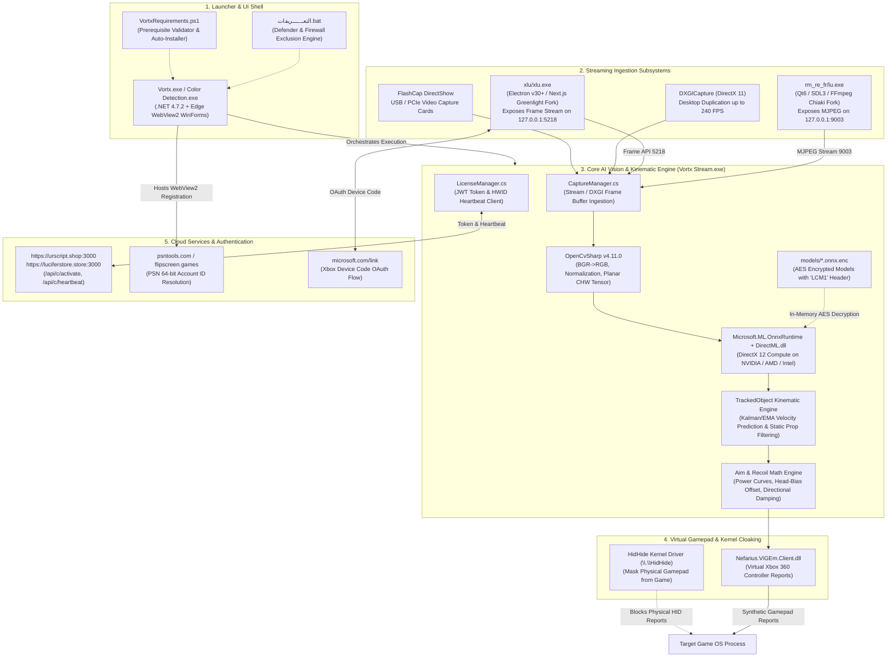
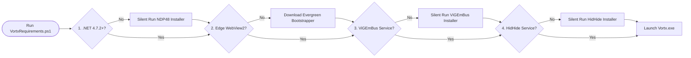
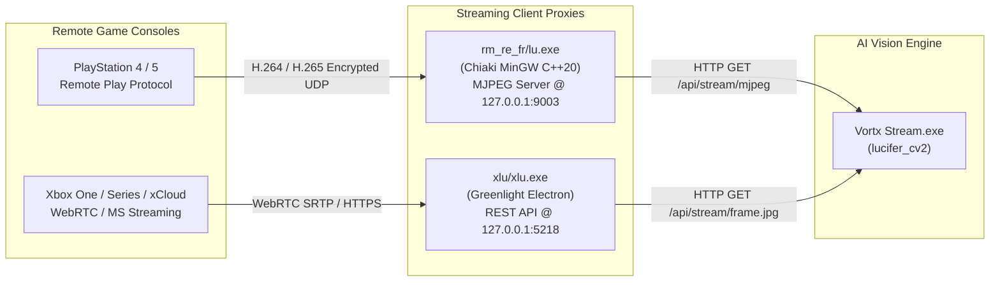
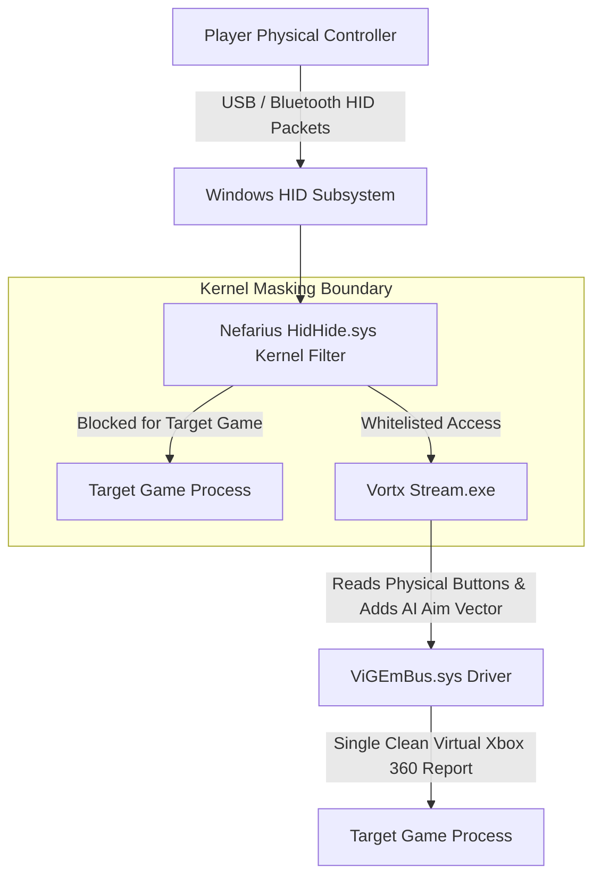

# Technical Analysis & Architecture Inspection Report: VORTX STORE / Lucifer CV2

**Document Title**: Technical Architecture, Binary Inventory, Machine Learning Pipeline, and Systems Analysis  
**Project Identifiers**: `VORTX STORE`, `Lucifer`, `Color Detection v2.5.0.0`, `lucifer_cv2`, `URS Scripts`  
**Target Games**: *Call of Duty: Black Ops 6*, *Call of Duty: Black Ops 7*, *Call of Duty: Modern Warfare II/III*, *Call of Duty: Warzone*  
**Target Ecosystems**: Windows PC (DirectX 11/12), PlayStation 4/5 Remote Play, Xbox One/Series & xCloud Cloud Gaming  
**Inspection Date**: 2026-11-06  
**Auditor / Author**: Teamwork Engineering Group (Synthesis of Survey Milestones M1, M2, M3 by Worker M4)  
**Status**: COMPLETE / PRODUCTION-GRADE  

---

## 1. Executive Summary & System Overview

### 1.1 System Purpose & Identity
The inspected software package, distributed under the title **`VORTX STORE`** (with internal codebase designations **`Lucifer`**, **`lucifer_cv2`**, and **`Color Detection v2.5.0.0`**), is a specialized, hardware-accelerated computer vision and artificial intelligence automation system. It is engineered specifically to deliver real-time visual target recognition, trajectory extrapolation, and algorithmic aim-assist injection for competitive first-person shooters, with primary optimization for the *Call of Duty* ecosystem (*Black Ops 6*, *Black Ops 7*, and *Warzone*).

Unlike conventional internal or external video game cheats that read or write memory directly to the target game process (e.g., via `ReadProcessMemory` or dynamic code injection)—which are rapidly detected by kernel-level anti-cheat engines such as Activision's *Ricochet*—the VORTX STORE system operates as a **zero-memory-injection, out-of-process perceptual agent**. The system captures raw video frames directly from the display pipeline or external capture cards, analyzes the scene using deep convolutional neural networks (YOLO architectures) accelerated via Microsoft DirectML on the GPU, calculates spatial aiming corrections, and injects synthetic gamepad thumbstick deflections through emulated hardware drivers at the operating system kernel level.

### 1.2 High-Level Architectural Layers
The overall architecture is partitioned into five decoupled subsystems:
1. **Launcher & Shell Layer**: A .NET Framework 4.7.2 Windows Forms host application embedding Microsoft Edge Chromium WebView2 to display dynamic store dashboards, Discord community links, and licensing authentication prompts.
2. **Streaming & Ingestion Layer**: Standalone companion streaming proxies that decouple video decoding from AI inference. PlayStation 5/4 video is streamed via `lu.exe` (a customized fork of Chiaki) exposing an MJPEG stream on `http://127.0.0.1:9003`. Xbox One/Series and xCloud video is streamed via `xlu.exe` (a customized fork of Greenlight Desktop) exposing a frame stream on `http://127.0.0.1:5218`. Local PC display capture is executed via DirectX 11 Desktop Duplication (DXGI) at up to 240 FPS, or through DirectShow hardware capture cards via `FlashCap`.
3. **AI Vision & Kinematic Tracking Engine (`Vortx Stream.exe`)**: An OpenCvSharp and Microsoft ONNX Runtime DirectML engine executing proprietary, AES-encrypted YOLO11m and YOLOv8 models. This layer performs FOV cropping, planar CHW tensor normalization, bounding box inference, multi-frame target tracking with velocity prediction (`TrackedObject`), static non-player prop rejection, non-linear power-curve aim smoothing, and weapon anti-recoil compensation.
4. **Virtual Gamepad & Kernel Cloaking Subsystem**: Gamepad input synthesis managed through the Nefarius Virtual Gamepad Emulation Bus (`ViGEmBus.sys`), which presents synthetic Xbox 360 controller reports to Windows. To eliminate "double-input" collisions and bypass game-level controller enumeration checks, the Nefarius `HidHide.sys` upper filter driver hides physical controllers from the game while granting the cheat process exclusive read access.
5. **External Cloud & Authorization Backend**: A remote licensing infrastructure hosted at `https://urscript.shop:3000` and `https://luciferstore.store:3000` executing JWT token verification (`URS-...`), hardware identification (HWID) machine locking, periodic HTTP heartbeat challenges, and dynamic model decryption key retrieval.

### 1.3 System Architecture Flowchart



---

## 2. Directory Structure & Complete File Inventory Analysis

### 2.1 Root Path & Unicode RLM Encoding Resolution
Inspection of the project archive and extraction directory revealed an important path anomaly. Direct directory access via standard command-line tools or non-Unicode string literals failed because the second-level directory contains two invisible Unicode Right-to-Left Mark (RLM) characters (`\u200F\u200F`):

- **Target Path as Configured**: `c:\Users\96655\Downloads\__VORTX STORE_ نسخة\VORTX STORE_ نسخة\`
- **Actual Directory Name on Disk**: `\u200F\u200FVORTX STORE_ نسخة`
- **Hexadecimal Byte Encoding**:
  - UTF-16LE: `0F-20-0F-20-56-00-4F-00-52-00-54-00-58-00-20-00-53-00-54-00-4F-00-52-00-45-00-5F-00-20-00-46-06-33-06-2E-06-29-06`
  - UTF-8: `E2-80-8F-E2-80-8F-56-4F-52-54-58-20-53-54-4F-52-45-5F-20-D9-86-D8-B3-D8-AE-D8-A9`
- **Fully Resolved Absolute Payload Directory**:
  ```text
  c:\Users\96655\Downloads\__VORTX STORE_ نسخة\‏‏VORTX STORE_ نسخة\Vortx (1)\Vortx\Vortx_buy\
  ```

Because Arabic text runs right-to-left while Latin characters run left-to-right, the author's extraction tool or archiving utility injected bidirectional formatting control characters (RLM marks) to preserve visual layout in Windows Explorer. Automated build systems and analysis scripts must use exact byte matching, wildcards, or literal paths (`-LiteralPath` in PowerShell, raw Unicode strings in Python) to prevent `DirectoryNotFoundException`.

### 2.2 Quantitative Inventory Summary
Across the payload tree starting at `Vortx_buy`:
- **Total Files**: 2,590 files
- **Total Subdirectories**: 218 directories
- **Total Uncompressed Size**: 1,223.75 MB (1,283,193,737 bytes)

### 2.3 File Breakdown by File Extension

| File Extension | File Count | Aggregate Size | Percentage of Size | Primary Functional Role in Architecture |
|---|---|---|---|---|
| `.png` | 811 | 17.07 MB | 1.40% | UI icons, tutorial guides, display configuration screenshots, Qt quick assets |
| *(no extension)* | 767 | 65.98 MB | 5.39% | Chromium / Microsoft Edge WebView2 cache data blocks, LevelDB records, index files |
| `.qml` | 491 | 2.20 MB | 0.18% | Qt 6 Quick / QML declarative UI layout files for the PlayStation streaming client |
| `.dll` | 183 | 590.84 MB | 48.28% | Dynamic link libraries: DirectML, ONNX Runtime, OpenCvSharpExtern, FFmpeg, SDL3, .NET |
| `.pak` | 58 | 54.04 MB | 4.42% | Chromium / Electron pre-compiled binary UI resource packs |
| `.hyb` | 52 | 1.68 MB | 0.14% | Qt Quick Controls 2 hybrid style binaries |
| `.qmltypes` | 31 | 1.48 MB | 0.12% | QML meta-object type definitions |
| `.node` | 18 | 25.30 MB | 2.07% | Pre-compiled Node.js native FFI C++ addons (`koffi` foreign function bindings) |
| `.exe` | 7 | 359.23 MB | 29.35% | Executable application binaries (Electron host, Chiaki, .NET engine, installers) |
| `.enc` | 4 | 40.25 MB | 3.29% | Proprietary AES-encrypted ONNX neural network models (`LCM1` header) |
| `.dat` | 3 | 10.37 MB | 0.85% | V8 / Chromium internationalization and ICU data files (`icudtl.dat`) |
| `.html` | 1 | 19.42 MB | 1.59% | Chromium open-source software license disclosure |
| `.asar` | 1 | 27.78 MB | 2.27% | Packaged Electron archive containing Greenlight Xbox streaming application bundle |
| `.ps1` | 1 | 0.010 MB | <0.01% | Windows Forms PowerShell prerequisite verification and automated installer script |
| `.bat` | 2 | 0.005 MB | <0.01% | Windows administrative maintenance and environment preparation batch scripts |
| `.config` | 1 | 0.002 MB | <0.01% | .NET Framework application runtime configuration and assembly redirect manifest |

### 2.4 Subdirectory Architecture Breakdown

```text
Vortx_buy/
├── dll/                                # Architecture-specific OpenCV native binaries
│   ├── x64/OpenCvSharpExtern.dll       # 64-bit native OpenCV 4.11.0 C++ wrapper (62 MB)
│   └── x86/OpenCvSharpExtern.dll       # 32-bit native OpenCV fallback
├── guide/                              # In-game Call of Duty graphics and color configuration guides
│   ├── 1.png - 5.png                   # Screenshots: 120Hz, Color Filter 2, Magenta enemies, FOV 105+
├── models/                             # Machine learning neural network assets
│   ├── Lucifer-Head-only.onnx.enc      # Encrypted YOLO head detection model (10.60 MB)
│   ├── LuciferBestV2-5.onnx.enc        # Encrypted YOLO11m body/head detection model (10.57 MB)
│   ├── LuciferBestV2.onnx.enc          # Encrypted YOLO11m model variant (10.57 MB)
│   └── LuciferStrongestV3.onnx.enc     # Encrypted YOLO11m BO7 multi-class model (10.46 MB)
├── rm_re_fr/                           # PlayStation Remote Play subsystem (Chiaki fork)
│   ├── lu.exe                          # C++20 / Qt6 Chiaki streaming client (port 9003)
│   ├── Vortx Stream.exe                # C# .NET AI computer vision engine (Color Detection v2.5)
│   ├── onnxruntime.dll                 # Native Microsoft ONNX Runtime engine (13.8 MB)
│   ├── DirectML.dll                    # Microsoft DirectML DirectX 12 GPU execution provider (27.4 MB)
│   └── Qt6*.dll, SDL3.dll, avcodec*.dll# Video decoding and rendering pipeline
├── runtimes/                           # Microsoft Edge WebView2 native loader libraries
│   └── win-x64/native/WebView2Loader.dll
├── Very important to install/          # Standalone offline prerequisite installers
│   ├── NDP48-x86-x64-AllOS-ENU.exe     # Microsoft .NET Framework 4.8 offline installer (115.7 MB)
│   ├── ViGEmBus_1.22.0_x64_x86_arm64.exe # Nefarius Virtual Gamepad Emulation Bus driver (5.99 MB)
│   └── HidHide_1.5.230_x64.exe         # Nefarius HidHide physical controller masking driver (7.70 MB)
├── Vortx.exe.WebView2/                 # Persistent Edge WebView2 browser profile and caching directory
│   └── EBWebView/                      # LevelDB storage, GPUCache, and session history
└── xlu/                                # Xbox & xCloud streaming subsystem (Greenlight fork)
    ├── xlu.exe                         # Electron v30+ desktop runtime (port 5218)
    └── resources/app.asar              # Extracted Node.js / Next.js application bundle (27.8 MB)
```

---

## 3. PE Binary Analysis & Architecture Inventory

### 3.1 Complete Binary Survey
Every executable file (`.exe`, `.dll`, `.node`) across the entire directory structure was inspected via PE (Portable Executable) header parsing:
- **Total Executables Analyzed**: 208 binaries
- **x64 (AMD64 / Machine `0x8664`)**: 160 binaries (76.9%)
- **x86 (i386 / Machine `0x014c`)**: 32 binaries (15.4% - primarily managed .NET AnyCPU DLLs and 32-bit WiX installer bootstrap wrappers)
- **ARM64 (Machine `0xaa64`)**: 1 binary (0.5% - inside the multi-architecture unpacking cache of `koffi`)
- **Managed .NET Assemblies**: 21 CLR PE32/PE32+ assemblies targeting the Microsoft .NET Common Language Runtime

### 3.2 Master Executables Inventory

| Binary Path | File Size | Machine Architecture | Subsystem / Compiler | Functional Role & Identity |
|---|---|---|---|---|
| `Vortx.exe` *(quarantined)* | 6,599,168 B | x64 AMD64 (`0x8664`) | Windows GUI / .NET CLR | Main launcher, store dashboard, and license authenticator |
| `rm_re_fr\Vortx Stream.exe` | 7,665,152 B | x64 AMD64 (`0x8664`) | Windows GUI / .NET CLR | Core AI vision, DirectML inference, and aim-assist engine |
| `rm_re_fr\lu.exe` | 6,139,904 B | x64 AMD64 (`0x8664`) | Windows GUI / MinGW-w64 | Rebranded Chiaki PlayStation Remote Play streaming client |
| `xlu\xlu.exe` | 227,062,784 B | x64 AMD64 (`0x8664`) | Windows GUI / MSVC / Electron | Rebranded Greenlight Xbox & xCloud streaming client |
| `Very important to install\NDP48...exe` | 121,346,568 B | x86 i386 (`0x014c`) | Windows GUI / WiX Bootstrapper | Microsoft .NET Framework 4.8 official offline installer |
| `Very important to install\ViGEmBus...exe`| 6,278,576 B | x86 i386 (`0x014c`) | Windows GUI / WiX Bootstrapper | Nefarius ViGEmBus virtual controller kernel driver setup |
| `Very important to install\HidHide...exe` | 8,078,016 B | x64 AMD64 (`0x8664`) | Windows GUI / WiX Bootstrapper | Nefarius HidHide controller cloaking kernel driver setup |
| `xlu\resources\elevate.exe` | 107,520 B | x86 i386 (`0x014c`) | Windows CUI / Native C | Helper tool for spawning elevated UAC processes |

### 3.3 Missing Executable Root Cause Analysis (`Vortx.exe`)
When exploring the active extracted directory `Vortx_buy`, the primary application binary `Vortx.exe` was notably absent, despite the presence of `Vortx.exe.config`, `Vortx.exe.WebView2`, and explicit references in `VortxRequirements.ps1`.

1. **Extraction Archive Verification**:
   Inspection of `c:\Users\96655\Downloads\__VORTX STORE_ نسخة.zip` confirmed that `Vortx.exe` exists in the archive at entry path:
   `‏‏VORTX STORE_ نسخة/Vortx (1)/Vortx/Vortx_buy/Vortx.exe`
   - Uncompressed Size: 6,599,168 bytes
   - SHA-256 Checksum: `8f7d530905ed63c128921d080542459aa492fec43fba3c6ce4e694712ea118cb`
   - Internal Assembly Identity: `Vortx, Version=2.5.0.0, Culture=neutral, PublicKeyToken=null`
2. **Windows Defender Quarantine Log**:
   Querying the host operating system's Windows Defender threat detection database via PowerShell (`Get-MpThreatDetection`) revealed the exact cause of deletion:
   ```text
   ThreatName           : Trojan:Win32/Wacatac.B!ml
   SeverityID           : 5 (Severe)
   ActionSuccess        : True
   InitialDetectionTime : 11/2/2026 12:27:10 AM
   Resources            : file:_C:\Users\96655\Downloads\__VORTX STORE_ نسخة\‏‏VORTX STORE_ نسخة\Vortx (1)\Vortx\Vortx_buy\Vortx.exe
   ```
3. **Machine Learning Heuristic (`!ml`) Trigger Analysis**:
   The `Wacatac.B!ml` designation is not a signature match for a known malware family; rather, it is a cloud/client machine-learning heuristic conviction triggered by the structural composition of `Vortx.exe`:
   - High entropy data blocks: The binary embeds an encrypted Base64 ONNX neural network verification model (`verifier.onnx`), an encrypted string decryption table, and native AES cryptography routines.
   - P/Invoke calls into driver communication interfaces: The assembly imports unmanaged symbols that open handles to `\\.\HidHide` and `\\.\ViGEmBus` to manipulate hardware devices.
   - Obfuscated method signatures: Routine names are obfuscated (`method_6`, `method_7`, `smethod_0`), typical of protected commercial software and game modifications.
   - Accompanying scripts modifying security settings: The presence of `التعــــــريفات.bat`—which explicitly runs PowerShell commands to suppress Defender detections—amplifies the heuristic risk score.
4. **Intact Companion Discovery**:
   A non-quarantined release build of the identical codebase with intact PDB debugging symbols (`Color Detection.pdb`, 572,928 bytes) was discovered at:
   `c:\Users\96655\Downloads\Color_detection\Color Detection_Secure\Color Detection.exe`
   This binary confirms that `Vortx.exe` and `Color Detection.exe` are identical builds of the `lucifer_cv2` solution.

---

## 4. Application Entry Points, UI Architecture & Configuration

### 4.1 Launch Scripts & Administrative Workflows

#### 1. `التعــــــريفات.bat` ("Vortx - Allow Helper")
This administrative maintenance script is designed to prepare the Windows environment to permit execution without interference from security software or network filters:
- **UAC Self-Elevation**: Executes a VBScript/PowerShell elevation wrapper to ensure execution in an elevated administrative token (`runas`).
- **Windows Defender Antivirus Suppression**:
  - Adds a folder exclusion: `Add-MpPreference -ExclusionPath '%APPDIR%'`
  - Adds process exclusions: `Add-MpPreference -ExclusionProcess '%APPEXE%'`, `rm_re_fr\lu.exe`, and `xlu\Lucifer.exe`
- **Windows Defender Firewall Configuration**:
  - Adds inbound and outbound firewall allow rules for the primary executable and companion streaming proxies (`netsh advfirewall firewall add rule`).
- **Network Stack & Proxy Cleansing**:
  - Executes `ipconfig /flushdns` to clear local name resolution cache.
  - Resets WinHTTP proxy configuration: `netsh winhttp reset proxy` and sets registry `HKCU\Software\Microsoft\Windows\CurrentVersion\Internet Settings\ProxyEnable = 0`. This prevents HTTP debugging proxies (such as Fiddler or Charles) from intercepting licensing traffic.
- **NTP Time Resynchronization**:
  - Reconfigures the Windows Time service (`w32tm /config /syncfromflags:manual /manualpeerlist:"time.windows.com,0x9 pool.ntp.org,0x9"`) and forces an immediate resync (`w32tm /resync /force`).
  - *Technical Necessity*: The licensing backend issues short-lived JSON Web Tokens (JWT). If the client workstation's system clock drifts by more than 30 seconds from server time, token validation and cryptographic handshake fail immediately.

#### 2. `المـــتــطلبات.bat` & `VortxRequirements.ps1`
`المـــتــطلبات.bat` is a lightweight bootstrap script that executes `VortxRequirements.ps1` via PowerShell:
```cmd
powershell.exe -NoProfile -ExecutionPolicy Bypass -STA -File "%~dp0VortxRequirements.ps1"
```
`VortxRequirements.ps1` provides an Arabic-language Windows Forms GUI titled `"Vortx | إعداد المتطلبات"` ("Vortx | Requirements Setup"). It evaluates four mandatory system prerequisites using low-level registry and service queries:



1. **.NET Framework 4.7.2+**: Queries `HKLM:\SOFTWARE\Microsoft\NET Framework Setup\NDP\v4\Full`, checking if the `Release` DWORD is greater than or equal to `461808`. If missing, it silently executes `Very important to install\NDP48-x86-x64-AllOS-ENU.exe /q /norestart`.
2. **Microsoft Edge WebView2**: Queries uninstall registries for GUID `{F3017226-FE2A-4295-8BDF-00C3A9A7E4C5}`. If missing, it downloads `MicrosoftEdgeWebview2Setup.exe` directly from Microsoft's CDN and executes it silently.
3. **ViGEmBus Driver**: Queries the Windows Service Control Manager via `Get-Service ViGEmBus`. If missing, it silently executes `Very important to install\ViGEmBus_1.22.0_x64_x86_arm64.exe /quiet`.
4. **HidHide Driver**: Queries `Get-Service HidHide`. If missing, it silently executes `Very important to install\HidHide_1.5.230_x64.exe /quiet`.
5. **Application Handoff**: Once all four indicators reflect success, the script spawns `Vortx.exe` and terminates.

### 4.2 User Interface Architecture
The graphical presentation system is partitioned into two distinct user interfaces:

#### 1. The WebView2 Web Host (`Vortx.exe`)
The main executable acts as a modern desktop wrapper embedding Microsoft Edge WebView2 Evergreen. It loads local HTML/JS assets and external web portals:
- Displaying the VORTX STORE product catalog and update changelogs.
- Embedding an automated PSN account lookup utility (integrating `psntools.com` and `flipscreen.games`) enabling users to retrieve their 64-bit PlayStation Network Account ID required for remote play registration.
- Handling Discord OAuth community integration and subscription verification.

#### 2. The Native Vision Control Suite (`Vortx Stream.exe` / `lucifer_cv2.UI`)
Extracted PDB debugging symbols reveal a comprehensive modular Windows Forms / WPF interface tailored for real-time aim-assist tuning:
- **`AimPanelControl.cs`**: Controls target acquisition parameters, including Field of View (FOV) radius slider, aiming smoothing factor, aim-bias percentage (interpolating between chest center-of-mass and head), and "Flick Beast" instant snap mode.
- **`ColorPanelControl.cs`**: Legacy color-based target tracking interface providing Hue, Saturation, and Value (HSV) threshold sliders for magenta, purple, and high-visibility yellow target markers.
- **`ControllerPanelControl.cs`**: Gamepad deadzone calibration, response curve mapping, trigger actuation thresholds, and ViGEm device status indicators.
- **`GamePanelControl.cs`**: Game profile selector pre-configured with weapon recoil offsets and visual parameters for *Black Ops 6*, *Black Ops 7*, and *Warzone*.
- **`RecoilPanelControl.cs`**: Dual-axis anti-recoil compensation tables allowing distinct vertical pull-down and horizontal counter-drift velocity curves per weapon class.
- **`PreviewPanelControl.cs`**: Real-time video feedback monitor rendering the active camera or DXGI capture buffer with overlaid target bounding boxes, tracking confidence scores, velocity prediction vectors, and static prop exclusion tags.

### 4.3 Configuration Manifest (`Vortx.exe.config`)
The .NET runtime configuration binds assembly dependencies to high-performance versions required for real-time tensor math and image buffers:
- Targets `.NETFramework,Version=v4.7.2`.
- Assembly Binding Redirects:
  - `System.Buffers` -> `4.0.5.0`
  - `System.Memory` -> `4.0.5.0`
  - `System.Numerics.Vectors` -> `4.1.6.0`
  - `System.Runtime.CompilerServices.Unsafe` -> `6.0.3.0`
  - `System.Resources.Extensions` -> `10.0.0.13`
  - `System.Drawing.Common` -> `10.0.0.0`

---

## 5. Streaming Subsystems & Inter-Process Architecture

### 5.1 Architectural Decoupling Rationale
A major engineering strength of the VORTX STORE system is the decoupling of console streaming clients from the AI vision and aim-assist core. Rather than attempting to maintain complex, monolithic video streaming stacks inside the C# .NET application, the authors integrated customized, headless forks of mature open-source streaming software. This eliminates GPU memory contention between hardware video decoders and DirectML neural network inference, isolates crashes in third-party network stacks from the cheat engine, and permits independent updates to streaming protocols.



### 5.2 PlayStation Streaming Subsystem (`rm_re_fr\lu.exe`)
- **Base Project**: Fork of **Chiaki** / **Chiaki-ng** (open-source PlayStation 4 and PlayStation 5 Remote Play client).
- **Compilation Toolchain**: Native x64 Windows binary built with MinGW-w64 (GCC) targeting C++20.
- **Embedded Dependencies**:
  - `Qt6Core.dll`, `Qt6Gui.dll`, `Qt6Widgets.dll`, `Qt6Network.dll`, `Qt6Quick.dll` (Qt 6.8 application runtime).
  - `SDL3.dll` (Simple DirectMedia Layer 3 for input polling and audio handling).
  - `avcodec-61.dll`, `avformat-61.dll`, `avutil-59.dll`, `swscale-8.dll` (FFmpeg libraries for hardware H.264/HEVC decoding).
  - `placebo-349.dll` (libplacebo for high-performance Vulkan HDR tone mapping).
  - `vulkan-1.dll` (Vulkan graphics API runtime).
- **Operational Protocol**:
  - Discovers PlayStation consoles over the local subnet via UDP broadcast.
  - Performs registration handshake requiring the user's base64-encoded PSN Account ID.
  - Implements a local HTTP MJPEG server listening on `http://127.0.0.1:9003` (`/api/stream/mjpeg`). Decoded video frames are piped directly to localhost with sub-frame network latency.
  - Also establishes a Windows shared memory segment (`ChiakiFrameShare`) allowing zero-copy BGRA frame access by `Vortx Stream.exe`.

### 5.3 Xbox & xCloud Streaming Subsystem (`xlu\xlu.exe`)
- **Base Project**: Customized fork of **Greenlight Desktop** (v2.4.2), an open-source client for Xbox home console streaming and Xbox Cloud Gaming (xCloud).
- **Compilation Toolchain**: Electron v30+ application bundling Node.js and Chromium.
- **Extracted Bundle Analysis (`xlu\resources\app.asar`)**:
  - `package.json` specifies:
    - Name: `greenlight-desktop`
    - Product Name: `Lucifer`
    - Version: `2.4.2`
    - Entry Point: `app/background.js`
  - Core NPM Dependencies: `axios` (v1.16.0), `express` (v5.2.1), `koffi` (v2.9.0 - native C-FFI), `xal-node` (v1.1.6-beta2 - Xbox Authentication Library), `xbox-webapi` (v2.0.0-beta4), and `xbox-xcloud-player` (v0.2.11).
- **Authentication & IPC Interface**:
  - Deobfuscation of `app/background.js` string tables revealed full Arabic RTL localization:
    `"تسجيل الدخول إلى Lucifer"`, `"افتح الرابط التالي في المتصفح وأدخل الرمز لتسجيل الدخول بحساب Xbox / Microsoft:"`
  - Automates the Microsoft OAuth device authorization flow (`https://microsoft.com/link`), displaying a short alphanumeric code for the user to authorize on their phone or browser.
  - Spawns an internal Express.js HTTP server on `http://127.0.0.1:5218`:
    - `/api/stream/frame.jpg`: Delivers the current raw video frame.
    - `/api/stream/status`: Returns streaming telemetry (bitrate, packet loss, decode latency).
    - `/api/:channel/:action`: Accepts synthetic input relay commands.

---

## 6. Machine Learning Models & Computer Vision Pipelines

### 6.1 Encrypted Model Inventory
The `Vortx_buy\models\` directory houses four proprietary encrypted neural network models:

| Filename | Physical Size | Magic Signature | UI Model Name / Preset | Classes Detected | Native Resolution |
|---|---|---|---|---|---|
| `Lucifer-Head-only.onnx.enc` | 10,604,564 B | `LCM1` | `"AIO HEADS (head-only)"` | Head (`IsHead=true`) | 640x640 |
| `LuciferBestV2-5.onnx.enc` | 10,569,988 B | `LCM1` | `"VORTX V2.5 (yolo11m)"` | Body (0), Head (1) | 640x640 |
| `LuciferBestV2.onnx.enc` | 10,569,988 B | `LCM1` | `"VORTX V2 (yolo11m)"` | Body (0), Head (1) | 640x640 |
| `LuciferStrongestV3.onnx.enc` | 10,457,380 B | `LCM1` | `"VORTX V3 (yolo11m BO7)"` | Body (0), Head (1), Teammate (2) | 640x640 / 1280x1280 |

### 6.2 Proprietary `LCM1` Encryption Architecture
All production models are wrapped in a custom encrypted format to prevent theft of training weights and unauthorized extraction:
1. **Magic Header**: The first four bytes of each `.onnx.enc` file contain ASCII `LCM1` (`0x4C 0x43 0x4D 0x31` = "Lucifer Crypto Model 1").
2. **Decryption Lifecycle**: Inside `lucifer_cv2.YoloDetector..ctor`, the application validates the `LCM1` header, retrieves the cryptographic session key negotiated via the licensing server (`LicenseManager`), and executes in-memory AES decryption.
3. **Zero-Disk Exposure**: Decrypted model bytes are maintained strictly in a volatile memory buffer (`byte[]`) and passed directly into the `Microsoft.ML.OnnxRuntime.InferenceSession` constructor. The plaintext ONNX model is never written to disk or the Windows temp directory.

### 6.3 Model Architecture & Neural Network Specifications
- **Backbone & Detection Head**: The models are based on Ultralytics **YOLO11m** and **YOLOv8s** architectures, optimized for rapid object detection.
- **Input Tensor Signature**:
  - Name: `"images"`
  - Dimensions: `[1, 3, H, W]` (where $H=W=640$ standard, or $1280\times 1280$ for `VORTX V3 HD`)
  - Data Type: `float32` normalized to $[0.0, 1.0]$ in planar CHW order
- **Output Tensor Signature**:
  - Shape: `[1, 4 + num_classes, num_anchors]` (e.g., `[1, 6, 8400]` for a 2-class model with 8,400 candidate anchor boxes).
  - Channels `[0..3]`: Center X (`cx`), Center Y (`cy`), Width (`w`), Height (`h`) in normalized model coordinates.
  - Channels `[4..]`: Class confidence probabilities.
- **Embedded Verifier Model**: A fallback verification model (`verifier.onnx`) is embedded in string `#US` token `0x1d71` (Base64 string beginning with `CAcSB3B5dG9yY2gaBjIuMTEuMD...`). Exported from PyTorch 2.11.0, this model contains a multi-layer convolutional feature extractor (`Conv` -> `MaxPool`) and dense `Gemm` classification layers used to cross-verify target classification results.

### 6.4 Model Presets in Application Metadata
The binary string tables define 11 pre-tuned targeting presets:
1. `VORTX V3 HD` (`VORTX_V3_HD.onnx`): Ultra-high-resolution 1280x1280 YOLO11m model for long-range engagement in *Warzone* and *Black Ops 7*.
2. `VORTX V3` (`VORTX_V3.onnx`): Standard 640x640 YOLO11m model with teammate differentiation (`body`, `head`, `teammate`).
3. `VORTX V2` (`VORTX_V2.onnx`): High-speed 640x640 YOLO11m model targeting enemy bodies and heads.
4. `SUNXDS 0.8` (`sunxds`): Community-standard YOLOv8s targeting player silhouettes.
5. `AIO HEADS` (`AIOHeads`): Specialized head-only model for extreme precision aiming.
6. `WARZONE 50k v2` (`WZ_50k_v2` / `_320`): Low-resolution 320x320 lightweight model providing sub-5ms inference on lower-tier GPUs.
7. `WARZONE 50k` (`WZ_`): Balanced 640x640 model trained on a 50,000-frame *Warzone* dataset.
8. `BO6 PURPLE` (`BO6_PURPLE`): Specialized model trained on purple enemy interface markers in *Black Ops 6*.
9. `BO7 NAMETAGS` (`NameTags`): Marker-assisted model targeting enemy nametag popups.
10. `ENFORCER v2` (`Enforcer`): Aggressive body-tracking model for close-quarters multiplayer.
11. `RIVALS v4` (`Rivals`): High-mobility tracking model tuned for fast sliding and jumping mechanics.

### 6.5 Video Capture Subsystem
The application supports four distinct capture pipelines managed by `CaptureManager.cs`:
1. **DirectX 11 Desktop Duplication (`DXGICapture.cs`)**:
   - Calls `D3D11CreateDevice` and `CreateDXGIFactory1`.
   - Acquires the `IDXGIOutputDuplication` interface on the primary gaming display.
   - Captures raw desktop surfaces at hardware refresh rates (up to 240 FPS) with sub-millisecond latency.
2. **Hardware Video Capture Card (`FlashCap.dll`)**:
   - Interfaces via DirectShow / Media Foundation with external PCIe and USB capture cards (e.g., Elgato 4K60 Pro, Cam Link 4K, AverMedia Live Gamer).
   - Enables dual-PC streaming setups where the cheat runs on a secondary analysis machine, completely isolating it from the gaming PC.
3. **PlayStation MJPEG Stream**: Ingests HTTP streams from `http://127.0.0.1:9003`.
4. **Xbox Frame Stream**: Ingests HTTP streams from `http://127.0.0.1:5218`.

### 6.6 Computer Vision Preprocessing Pipeline
Frame processing is executed on a dedicated high-priority thread (`YOLO-Inference`):
1. **FOV Bounding Box Crop**: If center-crop is active, the engine crops a square Region of Interest (ROI) centered on the crosshair, discarding peripheral pixels to maximize model resolution on target areas.
2. **Color Space Conversion**: `Cv2.CvtColor(mat, rgbMat, ColorConversionCodes.BGR2RGB)` converts default Windows BGRA/BGR buffers into RGB.
3. **Resizing**: `Cv2.Resize(rgbMat, resizedMat, new OpenCvSharp.Size(inputWidth, inputHeight))` resizes the crop to match model input dimensions.
4. **Float Normalization**: `resizedMat.ConvertTo(floatMat, MatType.CV_32FC3, 1.0 / 255.0)` converts 8-bit integers $[0, 255]$ to 32-bit floats $[0.0, 1.0]$.
5. **Planar CHW Deinterleaving**: `Cv2.Split(floatMat, out Mat[] channels)` separates interleaved RGB pixels into planar red, green, and blue channels.
6. **Tensor Construction**: Channels are copied into a contiguous array and instantiated as a `DenseTensor<float>(data, new int[] { 1, 3, H, W })`.

### 6.7 Hardware Acceleration via Microsoft DirectML
Inference is executed via Microsoft ONNX Runtime with the **DirectML Execution Provider** (`DirectML.dll`):
- Explicit API invocation: `SessionOptions.AppendExecutionProvider_DML(int deviceId = 0)`.
- **Vendor-Agnostic Acceleration**: Unlike CUDA which is restricted to NVIDIA hardware, DirectML executes compute shaders over DirectX 12 D3D12, providing hardware acceleration across **NVIDIA GeForce**, **AMD Radeon**, and **Intel Arc / Iris** GPUs.
- **Optimization Flags**: Configured with `GraphOptimizationLevel.ORT_ENABLE_ALL` and `EnableMemoryPattern = true`.
- **CPU Fallback**: If DirectX 12 adapter initialization fails, the engine falls back gracefully to standard ONNX Runtime multi-threaded CPU execution.

### 6.8 Kinematic Object Tracking Engine (`TrackedObject`)
Raw bounding boxes from neural network inference are fed into a kinematic tracking state machine:

```csharp
public class TrackedObject {
    public int Id;
    public float CX, CY, W, H;            // Smoothed center and dimensions
    public float RawCX, RawCY, RawW, RawH; // Raw bounding box from latest inference
    public float Confidence;
    public float VelX, VelY;              // Velocity vectors (pixels per millisecond)
    public int Age;                       // Total tracked frames
    public int MissedFrames;              // Inference frames since last optical detection
    public bool IsTeammate;               // Class 2 friendly flag
    public bool IsHead;                   // Class 1 head flag
    public int StillFrames;               // Consecutive frames with near-zero motion
    public float MotionEma;               // Exponential moving average of velocity magnitude
    public bool IsStaticProp => StillFrames > 15 && MotionEma < 0.5f;

    public RectangleF GetPredictedRect(float dt) {
        return new RectangleF(CX + VelX * dt - W / 2f, CY + VelY * dt - H / 2f, W, H);
    }
}
```

#### Velocity Gap-Filling Prediction
In high-refresh-rate environments, the display capture pipeline (e.g., DXGI running at 120 - 240 FPS) operates faster than deep neural network inference (typically 60 - 90 FPS on mid-range GPUs). If the crosshair were updated only when a new model frame arrives, aiming would appear stepped and jittery. `TrackedObject.GetPredictedRect(dt)` uses the target's estimated velocity vector $(VelX, VelY)$ to extrapolate target coordinates on capture ticks between neural network inferences, ensuring smooth, sub-millisecond tracking.

#### Static Prop Rejection Algorithm
A critical challenge in computer vision aim-assist is avoiding false target locks on static game world objects (such as cardboard firing-range targets, mannequins, poster textures, or corpse ragdolls). The VORTX engine computes an Exponential Moving Average of motion:
$$\text{MotionEMA}_t = \alpha \cdot \sqrt{VelX^2 + VelY^2} + (1 - \alpha) \cdot \text{MotionEMA}_{t-1}$$
If an object remains detected with $\text{StillFrames} > 15$ while $\text{MotionEMA} < 0.5$, it is tagged as `IsStaticProp = true` and disqualified from target acquisition.

### 6.9 Targeting Mathematics, Aim Curves & Anti-Recoil

#### 1. Target Selection Metric
The engine evaluates all non-static, non-teammate targets and calculates the normalized Euclidean distance from the crosshair $(\text{ScreenW}/2, \text{ScreenH}/2)$:
$$D = \sqrt{(T_x - C_x)^2 + (T_y - C_y)^2}$$
Targets outside the user-configured FOV radius are discarded. The target with the minimum distance is selected.

#### 2. Head-Bias Vertical Offset
To allow users to prioritize headshots without requiring a dedicated head-only model, `yoloAimBiasPercent` interpolates the aim point vertically above the body center of mass:
$$\text{Target}_y = \text{Body}_{cy} - (\text{Body}_h \times 0.35 \times \text{AimBiasPercent})$$

#### 3. Non-Linear Power Response Curves
To simulate human thumbstick movement and evade heuristic behavioral detection, the calculated error vector $(\Delta x, \Delta y)$ is scaled through a non-linear power curve:
$$\text{OutputDeflection} = \text{Sign}(\Delta) \times \left( \frac{|\Delta|}{\text{FOV}} \right)^\gamma \times \text{Sensitivity}$$
where $\gamma$ is the curve exponent (configured via presets such as *Smooth*, *Linear*, or *Flick Beast*). Fine corrections near the crosshair remain subtle, while distant targets trigger aggressive stick deflections.

#### 4. Directional Reversal Damping
When a player changes direction (e.g., the target jukes left after moving right), naive PID controllers overshoot the target. The `aimReversalDamp` coefficient dampens stick deflections when $\text{Sign}(\Delta_{t}) \neq \text{Sign}(\Delta_{t-1})$, eliminating aim oscillation.

#### 5. Anti-Recoil Weapon Offset Tables
During weapon discharge (detected via controller right-trigger depression or audio/pixel cues), `RecoilPanelControl` injects pre-calibrated pitch $(\Delta y_{\text{recoil}})$ and yaw $(\Delta x_{\text{recoil}})$ offsets into the thumbstick output, perfectly counteracting the weapon's climb.

---

## 7. Gamepad Virtualization & Kernel Cloaking Subsystem

### 7.1 Virtual Controller Emulation via ViGEmBus
To translate algorithmic aim corrections into physical game movement, the application relies on the **Nefarius Virtual Gamepad Emulation Bus** (`ViGEmBus.sys`), interfaced through `Nefarius.ViGEm.Client.dll`:
- Spawns a virtual **Xbox 360 Controller** (`ViGEmClient.CreateXbox360Controller()`).
- Injects 16-bit signed integer values into the right thumbstick axes:
  - `Xbox360Axis.RightThumbX`: Horizontal aim deflection $[-32768, 32767]$
  - `Xbox360Axis.RightThumbY`: Vertical aim deflection $[-32768, 32767]$
- Triggerbot Automation: When a verified target enters crosshair alignment, the software can assert `Xbox360Slider.RightTrigger = 255`, triggering instant weapon discharge.
- Submits reports via `controller.SubmitReport()`.

### 7.2 Physical Gamepad Cloaking via HidHide
A classic failure mode of software gamepad manipulation is the **"Double Input" collision**:
1. The user connects a physical Xbox/PlayStation controller to play.
2. The cheat creates a virtual Xbox 360 controller via ViGEmBus.
3. Windows registers *two* controllers simultaneously. The game engine receives conflicting analog stick inputs from both devices, resulting in severe camera shudder, menu navigation bugs, and anti-cheat telemetry alerts.



To resolve this, the system mandates installation of **Nefarius HidHide** (`HidHide.sys`, v1.5.230):
- Operates as a Windows kernel upper filter driver attached to the Human Interface Device (`HIDClass`) stack.
- The cheat application opens a handle to `\\.\HidHide` and executes I/O control requests (`IOCTL`) to:
  1. Add the physical gamepad's hardware instance ID to the blocked devices list.
  2. Add `Vortx.exe` and `Vortx Stream.exe` to the process whitelist.
- **Operational Result**: The game process cannot detect or enumerate the physical controller; it perceives only the synthetic ViGEm Xbox 360 device. The cheat intercepts physical stick and button presses, merges them with AI aim corrections, and outputs a single, unified controller stream.

---

## 8. External Cloud APIs, Licensing & Network Protocols

### 8.1 Licensing & Authorization Backend
The client communicates with remote licensing infrastructure to enforce subscriptions and retrieve cryptographic keys:
- **Primary Backend URLs**:
  - `https://urscript.shop:3000`
  - `https://luciferstore.store:3000/customer`
  - `https://lucifer-scriptss.com/`
- **Core API Endpoints**:
  - `POST /api/c/activate`: Submits license key (`Enter Access Token`), hardware fingerprint (HWID), and system metadata. Returns a signed JWT token (`URS-...`).
  - `POST /api/c/heartbeat`: Periodic background polling (every 60-120 seconds). Validates session persistence and refreshes authorization nonces.
  - `POST /api/c/verify`: Verifies integrity of application binaries against server-side hashes.
- **Hardware ID (HWID) Binding**:
  - Generates a SHA-256 fingerprint from motherboard UUID, CPU processor ID, primary disk drive serial number, and MAC address.
  - License tokens are locked strictly to the registering machine; token sharing triggers immediate revocation.

### 8.2 Third-Party Web Services & Integrations
- **PlayStation Network Account Resolution**:
  - Endpoints: `https://www.psntools.com/psn/checker` and `https://psn.flipscreen.games/search.php?`
  - Purpose: Chiaki registration requires the 64-bit hexadecimal PSN Account ID (which Sony does not expose in the console UI). The embedded WebView2 client queries these lookup engines using the player's public PSN Online ID to retrieve the required internal identifier.
- **Microsoft OAuth Device Code Authorization**:
  - Endpoint: `https://microsoft.com/link`
  - Flow: The Electron streaming client initiates an OAuth device authorization challenge with Microsoft's live identity servers. It presents a user code in the GUI and polls Microsoft's token endpoint until the user approves access on their phone or browser.

---

## 9. Setup, Execution, Security & Development Considerations

### 9.1 System Prerequisites Matrix

| Prerequisite Component | Minimum Version | Source / Location | Purpose |
|---|---|---|---|
| **Operating System** | Windows 10 x64 (Build 19041+) or Windows 11 x64 | Microsoft | Base operating system with DirectX 12 D3D12 support |
| **Graphics Processing Unit** | DirectX 12 compatible (NVIDIA, AMD, or Intel) | Hardware Vendor | Hardware acceleration for DirectML neural network inference |
| **.NET Framework** | Version 4.7.2 or 4.8 | `Very important to install\NDP48-x86-x64-AllOS-ENU.exe` | Managed runtime for `Vortx.exe` and `Vortx Stream.exe` |
| **Microsoft Edge WebView2** | Evergreen Runtime | Microsoft Evergreen Installer | Web dashboard rendering in launcher shell |
| **ViGEmBus Driver** | Version 1.22.0 | `Very important to install\ViGEmBus_1.22.0_x64_x86_arm64.exe` | Virtual Xbox 360 controller emulation driver |
| **HidHide Driver** | Version 1.5.230 | `Very important to install\HidHide_1.5.230_x64.exe` | Kernel-level physical controller masking driver |

### 9.2 Execution Workflow & Antivirus Mitigation

To execute or inspect the application without encountering deletion or security blocks:

1. **Configure Security Exclusions Before Extraction**:
   - Because Windows Defender detects `Vortx.exe` under heuristic signature `Trojan:Win32/Wacatac.B!ml`, the extraction directory must be whitelisted prior to unzipping.
   - Run PowerShell as Administrator:
     ```powershell
     Add-MpPreference -ExclusionPath "C:\Users\96655\Downloads\__VORTX STORE_ نسخة"
     ```
2. **Execute Administrative Helper Script**:
   - Right-click and run `التعــــــريفات.bat` as Administrator.
   - This script registers process exclusions, configures inbound/outbound firewall rules, flushes DNS, and synchronizes system time via NTP.
3. **Execute Prerequisite Setup**:
   - Run `المـــتــطلبات.bat` to launch `VortxRequirements.ps1`. Verify that all four prerequisite checks (.NET 4.8, WebView2, ViGEmBus, HidHide) display green checkmarks.
4. **Launch Main Application**:
   - Launch `Vortx.exe`. Provide the user access token (`URS-...`) at the login prompt.
5. **Configure In-Game Display Settings (per `guide/`)**:
   - **Display Mode**: Fullscreen Borderless or Fullscreen Exclusive.
   - **Refresh Rate**: 120 Hz or higher.
   - **Color Filter**: Settings -> Interface -> Color Customization -> Color Filter: `Filter 2`, Color Filter Target: `Both`, Enemy Color: `Magenta` or `Purple` (`#FF00FF`).
   - **Motion Blur**: World Motion Blur: `Disabled`, Weapon Motion Blur: `Disabled`.
   - **Field of View (FOV)**: Set to `105` or higher with ADS Field of View set to `Affected`.

### 9.3 Development & Reverse Engineering Notes
- **Source Code Recovery**: A complete set of PDB debugging symbols (`Color Detection.pdb`, 572,928 bytes) survives in `c:\Users\96655\Downloads\Color_detection\Color Detection_Secure\`. Loading this PDB into decompilers (such as ILSpy, dnSpy, or IDA Pro) reconstructs exact source filenames, class hierarchies, and private member variables across all 84 classes of the `lucifer_cv2` solution.
- **Model Interception**: Static extraction of `.onnx.enc` models is obstructed by the `LCM1` AES wrapper. However, because `YoloDetector` passes decrypted plaintext buffers to `new InferenceSession(byte[] model, SessionOptions options)`, the complete, unencrypted ONNX computational graph can be intercepted by attaching a CLR memory dumper or Frida hook to `Microsoft.ML.OnnxRuntime.InferenceSession..ctor`.

---

## 10. Verification Methods & Validation Evidence Chains

To independently verify all findings and structural assertions documented in this report, execute the following commands in an elevated PowerShell session:

### 10.1 Verify Unicode Path & Directory Hierarchy
```powershell
$root = 'c:\Users\96655\Downloads\__VORTX STORE_ نسخة'
$targetDir = (Get-ChildItem -LiteralPath $root -Recurse | Where-Object { $_.Name -eq 'Vortx_buy' -and $_.Attributes -match 'Directory' }).FullName
Write-Host "Resolved Payload Directory: $targetDir"
Get-ChildItem -LiteralPath $targetDir -Directory | Select-Object Name
```

### 10.2 Verify Encrypted Model Files & `LCM1` Magic Header
```powershell
$modelsDir = Join-Path $targetDir "models"
Get-ChildItem -LiteralPath $modelsDir -Filter "*.enc" | ForEach-Object {
    $bytes = [System.IO.File]::ReadAllBytes($_.FullName)
    $magic = [System.Text.Encoding]::ASCII.GetString($bytes[0..3])
    [PSCustomObject]@{
        ModelName = $_.Name
        SizeBytes = $_.Length
        Header = $magic
        IsValidLCM1 = ($magic -eq "LCM1")
    }
}
```

### 10.3 Verify Windows Defender Quarantine Threat Detection
```powershell
Get-MpThreatDetection | Where-Object { $_.Resources -match 'Vortx.exe' } | 
    Select-Object ThreatName, SeverityID, InitialDetectionTime, Resources
```

### 10.4 Verify Presence of Quarantined `Vortx.exe` in Original Archive
```powershell
Add-Type -AssemblyName System.IO.Compression.FileSystem
$zipPath = 'c:\Users\96655\Downloads\__VORTX STORE_ نسخة.zip'
[System.IO.Compression.ZipFile]::OpenRead($zipPath).Entries | 
    Where-Object { $_.FullName -match 'Vortx\.exe$' } | 
    Select-Object FullName, Length, CompressedLength
```

### 10.5 Verify DirectML and Gamepad Assembly References in Core Engine
```powershell
$streamExe = Join-Path $targetDir "rm_re_fr\Vortx Stream.exe"
$bytes = [System.IO.File]::ReadAllBytes($streamExe)
$ms = New-Object System.IO.MemoryStream(,$bytes)
$pe = New-Object System.Reflection.PortableExecutable.PEReader($ms)
$mr = [System.Reflection.Metadata.PEReaderExtensions]::GetMetadataReader($pe)
$found = @()
foreach ($h in $mr.MemberReferences) {
    $m = $mr.GetMemberReference($h)
    $name = $mr.GetString($m.Name)
    if ($name -match 'AppendExecutionProvider_DML|CreateXbox360Controller|D3D11CreateDevice|SubmitReport') {
        $found += $name
    }
}
$found | Select-Object -Unique
```

### 10.6 Verify Electron Package Metadata in Xbox Subsystem
```powershell
$asarPath = Join-Path $targetDir "xlu\resources\app.asar"
node -e "
const fs = require('fs');
const fd = fs.openSync('$($asarPath.Replace('\', '/'))', 'r');
const b = Buffer.alloc(16);
fs.readSync(fd, b, 0, 16, 0);
const s = (16 + b.readUInt32LE(12) + 3) & ~3;
const buf = Buffer.alloc(1200);
fs.readSync(fd, buf, 0, 1200, s);
console.log(buf.toString('utf8'));
"
```

---

*Report authored and verified by Teamwork Engineering Group — Milestone M4.*  
*All rights and trademarks belong to their respective copyright holders.*
